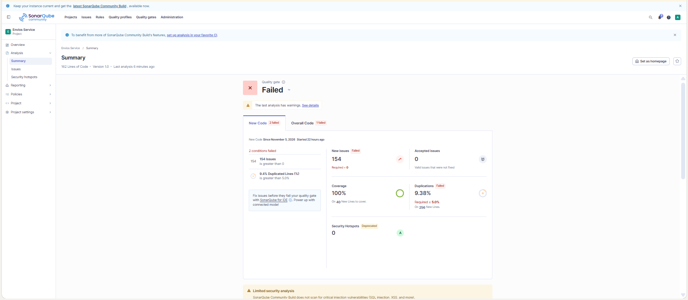
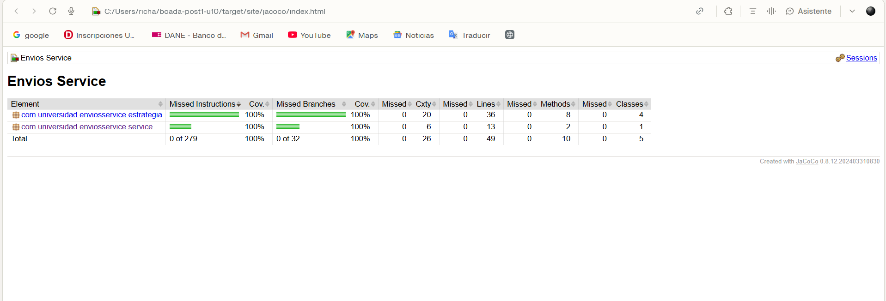

# Envios Service — Diagnóstico y Mejora Guiada por Métricas

Proyecto Maven (Java 21) que calcula el costo de un envío. En la Parte 1 se diagnostica con SonarQube y JaCoCo un método con complejidad ciclomática alta y baja cobertura; en la Parte 2 se refactoriza con el patrón Strategy, se amplían las pruebas y se evalúa un Quality Gate propio.

## Decisiones de diseño

### 1. Entorno de análisis
SonarQube Community Build local con Docker (contenedor `sonarqube`, puerto 9000) y JaCoCo 0.8.12. Se eligió sobre SonarCloud por dos criterios: (1) control total de la configuración, necesario para crear un Quality Profile y un Quality Gate propios, y (2) independencia de la conectividad y de los límites de un plan gratuito. El costo asumido es el consumo de recursos de la máquina y mantener el contenedor corriendo, viable con 7.6 GiB asignados a Docker Desktop.

### 2. Exclusiones del análisis
No se excluyó ninguna clase (`sonar.exclusions` vacío). El proyecto solo contiene lógica de negocio y no hay una clase de arranque (`Main`) sin lógica que distorsione el porcentaje de cobertura. Excluir código con lógica ocultaría justo lo que la métrica debe mostrar.

### 3. Métrica usada como señal principal
Se usó la **complejidad ciclomática** (20 en `calcularCosto()`). Cuenta los caminos independientes del método, es decir, el mínimo de casos de prueba necesarios, así que une el diagnóstico de complejidad con el hueco de cobertura. La complejidad cognitiva (32) apunta al mismo método, pero mide dificultad de lectura y orienta menos sobre cuántas pruebas faltan. La cobertura (23.8% de líneas, 18.4% de ramas) dice cuánto falta probar, pero no por qué ni dónde está el origen estructural. Además es la métrica que un refactor por patrón de diseño reduce directamente, lo que permite medir el antes y el después.

### 4. Patrón elegido: Strategy
`calcularCosto()` no guarda estado entre llamadas (la clase no tiene campos), lo que descarta **State**, que requiere un estado interno con transiciones válidas. Tampoco encadena manejadores: los cuatro métodos de envío son excluyentes, solo uno coincide con `metodoEnvio` y el orden de evaluación no cambia el resultado, lo que descarta **Chain of Responsibility**. Cada rama de `metodoEnvio` calcula el mismo tipo de resultado (un costo) con una fórmula propia, elegida una sola vez por un valor discreto de entrada: es el caso de **Strategy**.

A cada estrategia (paquete `estrategia`) se movió la fórmula por tramos de peso y los recargos propios de su método de envío (distancia, factor 1.3 de EXPRESS, límite de 300 km de OVERNIGHT). Se quedaron en el orquestador `ServicioCalculoEnvio` el ajuste por fragilidad y el descuento por tipo de cliente, porque son reglas transversales a todos los métodos: incluirlas en cada estrategia las duplicaría cuatro veces. Por eso la complejidad del orquestador no bajó a 1 sino a 5.

### 5. Criterio de pruebas agregadas
Cada prueba nueva corresponde a una rama que el reporte JaCoCo de la Parte 1 mostraba sin cubrir y verifica un valor calculado distinto:

| Rama sin cubrir (Parte 1) | Prueba que la cubre |
|---|---|
| ESTANDAR, tramos de 5 a 20 kg y de 20 kg en adelante | `EnvioEstandarStrategyTest.calculaCostoPorTramoDePeso` |
| ESTANDAR, recargo de 10 por más de 500 km | `aplicaRecargoSoloSiLaDistanciaSuperaLos500Km` (500 km sin recargo, 501 km con recargo) |
| EXPRESS, toda la rama y el factor 1.3 | `EnvioExpressStrategyTest` (tramos, recargo de 25 y borde de 500 km) |
| OVERNIGHT, toda la rama | `EnvioOvernightStrategyTest.calculaCostoPorTramoDePeso` y `permiteExactamente300Km` |
| OVERNIGHT, excepción por más de 300 km | `rechazaDistanciasMayoresA300Km` |
| INTERNACIONAL, toda la rama y recargo de 100 | `EnvioInternacionalStrategyTest` (tramos y borde de 5000 km) |
| Método no soportado | `ServicioCalculoEnvioTest.rechazaMetodoDeEnvioNoSoportado` |
| Fragilidad (`esFragil = true`) | `aplicaRecargoPorFragilidad` |
| Descuento CORPORATIVO | `aplicaDescuentoClienteCorporativo` |

Se probaron los valores límite (500/501 km, 300/301 km, 5000/5001 km) porque ahí cambia el resultado, y `combinaFragilidadYDescuentoSobreElCostoDeLaEstrategia` verifica el orden de las reglas transversales. Al calcular el valor esperado de OVERNIGHT con 25 kg se obtuvo 272.5, no el 250.0 que sugería el material de la guía, que no coincide con la fórmula del código. En total la suite tiene 26 pruebas.

### 6. Realismo de los umbrales del Quality Gate
**Complejidad por método = 10.** SonarQube no permite limitar la complejidad de un método individual desde el Quality Gate (sus condiciones operan sobre métricas agregadas), así que el límite se configura en el Quality Profile "Estándar Laboratorio" con la regla `java:S1541` (Threshold = 10). Se eligió 10 por ser el techo del rango "Moderada" de la Tabla 3.2 de la guía: es exigente (el `calcularCosto()` original, con 20, lo habría incumplido) sin forzar la reescritura de métodos todavía razonables. Un umbral de 5 obligaría a fragmentar métodos simples y uno de 20 dejaría pasar el método problemático.

**Cobertura = 70%.** Exigir 100% es poco realista y empuja a escribir pruebas triviales para llenar el número (incentivo perverso, Sección 2.3 de la guía). El 70% deja margen para código de infraestructura sin obligar a probarlo con pruebas vacías.

**Duplicación ≤ 5% en código nuevo.** Evita que el refactor introduzca lógica repetida sin volverse una restricción irreal.

**Observación sobre el perfil por defecto.** En la instancia usada, la regla S1541 no estaba activa en ningún perfil incorporado (la lista de perfiles de la regla aparecía vacía; el valor por defecto de su parámetro es 10). Eso explica que el primer análisis reportara 0 Code Smells aunque `calcularCosto()` tenía complejidad 20.

## Comparación antes / después

| Métrica | Antes (Parte 1) | Después (Parte 2) |
|---------|------------------|--------------------|
| Complejidad ciclomática de calcularCosto() | 20 | 5 (−75%) |
| Complejidad cognitiva del orquestador | 32 | 4 |
| Complejidad de cada estrategia | — | 4 |
| Cobertura de ramas | 18.4% | 100% (+81.6 puntos) |
| Cobertura de líneas | 23.8% | 100% |
| Code Smells | 0 | 175 (ver nota) |
| Duplicación | 0.0% | 12.8% (9.375% en código nuevo) |
| Quality Gate | — | Failed |

La complejidad total del proyecto pasó de 20 a 21, porque la lógica se repartió en cinco clases. Lo que bajó fue la complejidad del método más complejo, que era el objetivo.

### Resultado del Quality Gate "Estándar Laboratorio": Failed

| Condición | Valor | Umbral | Estado |
|---|---|---|---|
| Coverage (código completo) | 100.0% | menor a 70% | Cumple |
| Duplicated Lines % (código nuevo) | 9.375% | mayor a 5% | **Falla** |
| Issues (código nuevo) | 154 | mayor a 0 | **Falla** |
| Maintainability Issues (código completo) | 175 | mayor a 0 | **Falla** |

La condición de duplicación falla por una razón con sentido: las cuatro estrategias repiten la misma estructura de tramos de peso (menos de 5 kg, de 5 a 20 kg, más de 20 kg). Es duplicación estructural que se aceptó a cambio de aislar las fórmulas de cada método de envío, y una mejora posible sería extraer una tabla de tarifas parametrizada.

**Nota sobre los 175 issues.** No se analizó su origen ni qué reglas los generan. El perfil de Java "Estándar Laboratorio" quedó con 786 reglas activas, casi todo el catálogo de Java, mientras que el primer análisis, con un perfil incorporado más acotado, reportó 0. La hipótesis es que la cantidad de reglas activas explica gran parte de estos issues y que no son consecuencia de la refactorización, pero no se verificó. La condición de Maintainability Issues sobre código completo quedó configurada además de la de Issues nuevos, con lo que el gate evalúa cuatro condiciones.

## Capturas

## Herramientas utilizadas
- Java 21 (compilado con JDK 23), Apache Maven 3.9
- SonarQube Community Build (Docker), JaCoCo 0.8.12, JUnit 5
- Git, GitHub

## Conclusiones
La complejidad ciclomática y la cobertura baja apuntaban al mismo método, y el patrón Strategy redujo la complejidad de `calcularCosto()` de 20 a 5 al separar la fórmula de cada método de envío de las reglas transversales. Las pruebas agregadas se diseñaron a partir de las ramas rojas del reporte JaCoCo, incluidos los valores límite, y llevaron la cobertura de ramas de 18.4% a 100%. El Quality Gate falló, y eso resultó más informativo que un resultado limpio: mostró que repartir el código entre clases similares genera duplicación, y que un perfil con casi todas las reglas activas produce ruido que hay que filtrar antes de tomar el gate como veredicto. Un umbral de calidad solo sirve si el perfil que lo alimenta está bien calibrado.