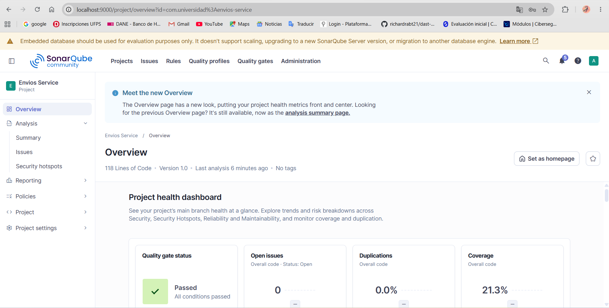
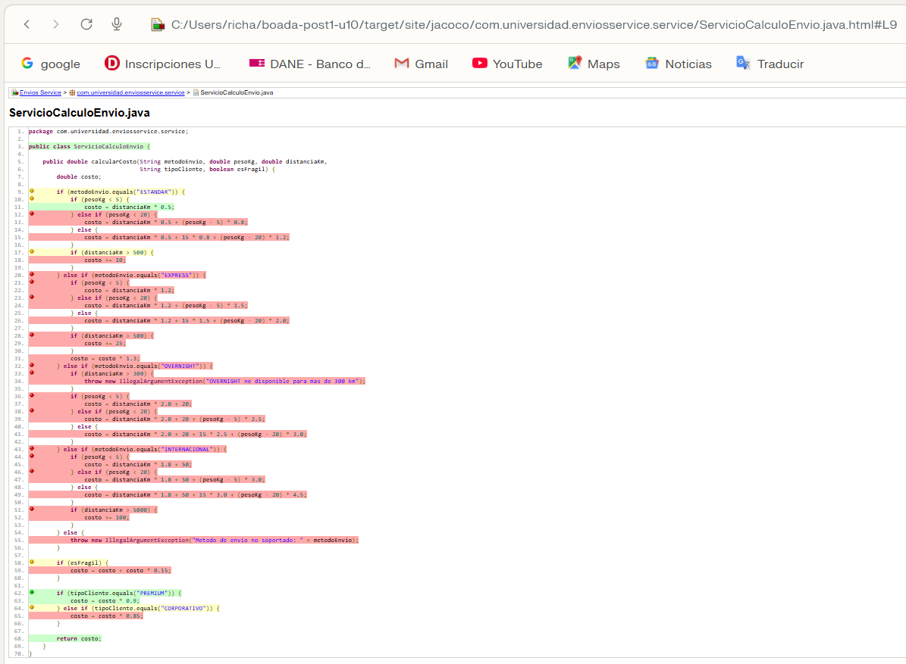

# Envios Service — Análisis de Métricas de Calidad

## Entorno de análisis

SonarQube Community Build local, ejecutado en Docker (contenedor `sonarqube`, puerto 9000), con JaCoCo 0.8.12 para la cobertura.

**Decisión de diseño 1 — Entorno de análisis.** Se eligió SonarQube local con Docker en lugar de SonarCloud por dos criterios: (1) control total de la configuración, necesario en la Parte 2 para duplicar el perfil "Sonar Way", activar la regla S1541 y crear el Quality Gate "Estándar Laboratorio"; (2) independencia de la conectividad y de los límites de un plan gratuito. El costo asumido es el consumo de recursos de la máquina local y mantener el contenedor corriendo durante el laboratorio, algo viable con 7.6 GiB de memoria asignados a Docker Desktop.

**Decisión de diseño 2 — Exclusiones del análisis.** No se excluyó ninguna clase (`sonar.exclusions` vacío). El proyecto solo contiene `ServicioCalculoEnvio` y, tras la Parte 2, las clases de estrategia, todas con lógica de negocio real. No existe una clase de arranque (`Main`) sin lógica cuya falta de pruebas distorsione el porcentaje global. Excluir código con lógica ocultaría justamente lo que la métrica debe mostrar.

## Estado inicial del análisis

| Métrica | Valor real observado |
|---------|----------------------|
| Complejidad ciclomática de calcularCosto() | 20 |
| Cognitive Complexity | 32 |
| Cobertura de líneas de ServicioCalculoEnvio | 23.8% |
| Cobertura de ramas de ServicioCalculoEnvio | 18.4% (JaCoCo: 7 de 38 ramas cubiertas) |
| Code Smells reportados | 0 |

## Interpretación

`ServicioCalculoEnvio.calcularCosto()` concentra el problema: es el único método con lógica de la clase y acumula los 20 caminos independientes. La suite inicial solo ejercita dos caminos (`ESTANDAR`, peso menor a 5 kg, clientes `REGULAR` y `PREMIUM`), por eso 31 de 38 ramas quedaron sin cubrir.

Según el reporte HTML de JaCoCo, las ramas sin cubrir son:

| Zona del método | Qué quedó sin cubrir |
|---|---|
| `ESTANDAR` | Tramos de peso de 5 a 20 kg y de 20 kg en adelante, y el recargo de 10 por distancia mayor a 500 km |
| `EXPRESS` | Toda la rama: tres tramos de peso, recargo de 25 por distancia mayor a 500 km y el factor 1.3 |
| `OVERNIGHT` | Toda la rama, incluido el `IllegalArgumentException` para distancias mayores a 300 km |
| `INTERNACIONAL` | Toda la rama: tres tramos de peso y recargo de 100 por distancia mayor a 5000 km |
| Método no soportado | El `IllegalArgumentException` del `else` final |
| Fragilidad | El caso `esFragil = true` (recargo del 15%) |
| Tipo de cliente | El descuento `CORPORATIVO` |

La complejidad y la baja cobertura apuntan al mismo método porque la lógica está concentrada en un solo método con una cadena de condicionales, y cada condicional añade a la vez un camino que probar y una rama sin ejercitar.

Sonar reporta 0 Code Smells aunque la complejidad es 20 y la cognitiva 32. El Quality Gate por defecto aparece como "Passed". Ninguna de las dos cosas señala el problema real, lo que motiva configurar un Quality Profile y un Quality Gate propios en la Parte 2.

**Decisión de diseño 3 — Métrica usada como señal principal.** Se usó la **complejidad ciclomática** (20). Cuenta directamente los caminos independientes del método, es decir, el mínimo de casos de prueba necesarios, así que une el diagnóstico de complejidad con el hueco de cobertura. La complejidad cognitiva (32) coincide en señalar el mismo método, pero mide la dificultad de lectura (penaliza la anidación) y no orienta tanto cuántas pruebas faltan. La cobertura (23.8% de líneas, 18.4% de ramas) dice cuánto falta probar, pero no por qué ni dónde está el origen estructural. La complejidad ciclomática además es la métrica que reduce directamente un refactor por patrón de diseño, así que permite medir el antes y el después.

## Capturas del análisis inicial

